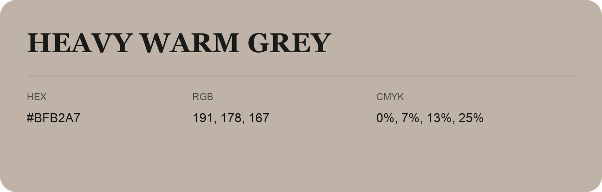

## Heavy Warm Grey

- HEX: #BFB2A7
- RGB: 191, 178, 167
- CMYK: 0%, 7%, 13%, 25%
- Character: quiet, balanced, understated
- Suggested uses: professional services, minimal identities, supporting backgrounds

- Source images: IMG_9057.JPG
