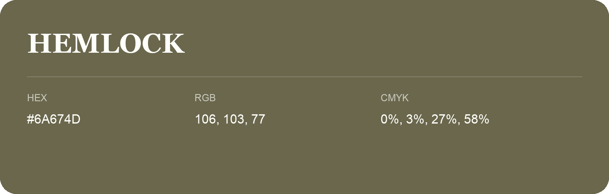

## Hemlock

- HEX: #6A674D
- RGB: 106, 103, 77
- CMYK: 0%, 3%, 27%, 58%
- Character: sunny, lively, optimistic
- Suggested uses: friendly consumer brands, food packaging, cheerful accents

- Source images: IMG_9106.JPG
