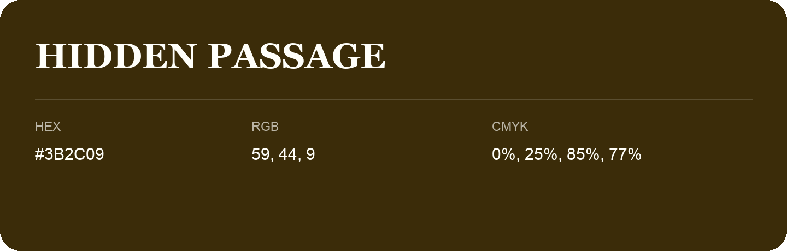

## Hidden Passage

- HEX: #3B2C09
- RGB: 59, 44, 9
- CMYK: 0%, 25%, 85%, 77%
- Character: earthy, rich, warm
- Suggested uses: premium packaging, rustic brands, dark backgrounds

- Source images: IMG_9081.JPG
