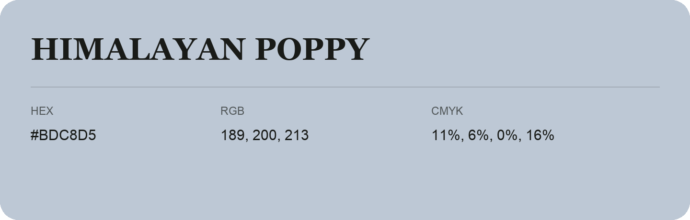

## Himalayan Poppy

- HEX: #BDC8D5
- RGB: 189, 200, 213
- CMYK: 11%, 6%, 0%, 16%
- Character: quiet, balanced, understated
- Suggested uses: professional services, minimal identities, supporting backgrounds

- Source images: IMG_9067.JPG

- Data provenance: RGB calculated from HEX, matching the page; source image RGB was unreadable.
