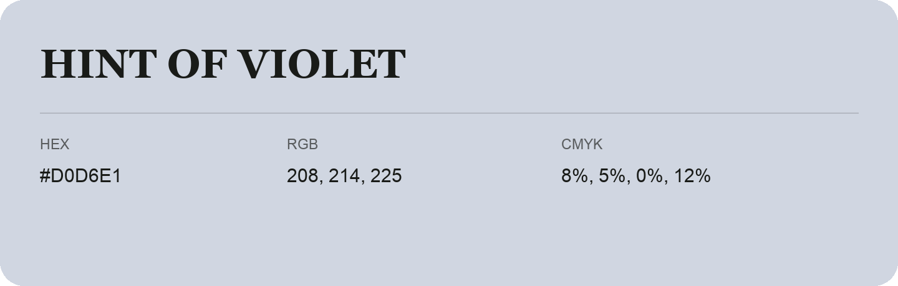

## Hint of Violet

- HEX: #D0D6E1
- RGB: 208, 214, 225
- CMYK: 8%, 5%, 0%, 12%
- Character: quiet, balanced, understated
- Suggested uses: professional services, minimal identities, supporting backgrounds

- Source images: IMG_9088.JPG
