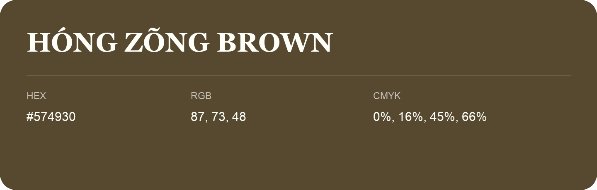

## Hóng Zõng Brown

- HEX: #574930
- RGB: 87, 73, 48
- CMYK: 0%, 16%, 45%, 66%
- Character: earthy, rich, warm
- Suggested uses: premium packaging, rustic brands, dark backgrounds

- Source images: IMG_9009.JPG
