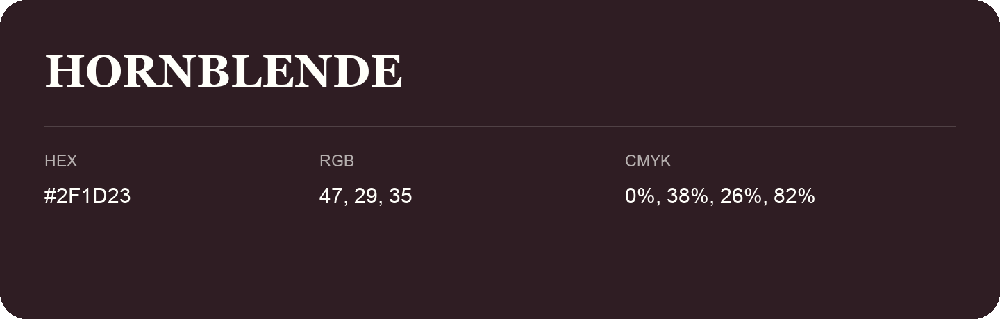

## Hornblende

- HEX: #2F1D23
- RGB: 47, 29, 35
- CMYK: 0%, 38%, 26%, 82%
- Character: deep, grounded, understated
- Suggested uses: premium packaging, editorial typography, dark backgrounds

- Source images: iCloud Photos 2/IMG_9168.JPG
