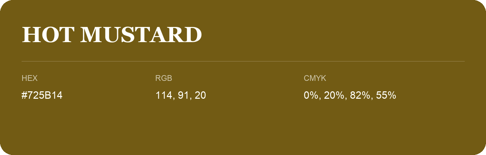

## Hot Mustard

- HEX: #725B14
- RGB: 114, 91, 20
- CMYK: 0%, 20%, 82%, 55%
- Character: sunny, lively, optimistic
- Suggested uses: friendly consumer brands, food packaging, cheerful accents

- Source images: iCloud Photos 2/IMG_9128.JPG
