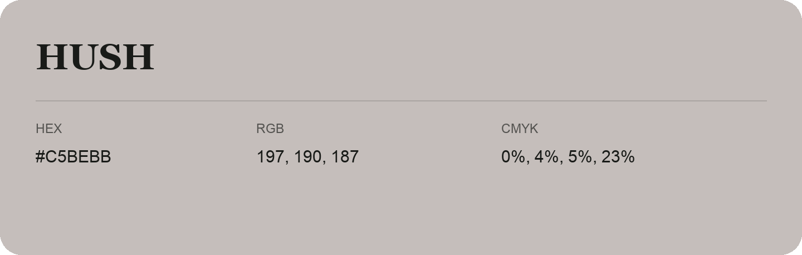

## Hush

- HEX: #C5BEBB
- RGB: 197, 190, 187
- CMYK: 0%, 4%, 5%, 23%
- Character: quiet, balanced, understated
- Suggested uses: professional services, minimal identities, supporting backgrounds

- Source images: IMG_9058.JPG
