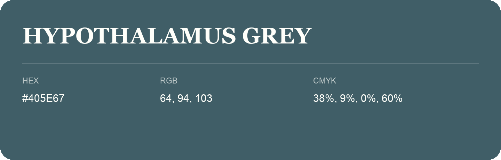

## Hypothalamus Grey

- HEX: #405E67
- RGB: 64, 94, 103
- CMYK: 38%, 9%, 0%, 60%
- Character: calm, fresh, composed
- Suggested uses: wellness brands, coastal hospitality, modern service brands

- Source images: IMG_8994.JPG
