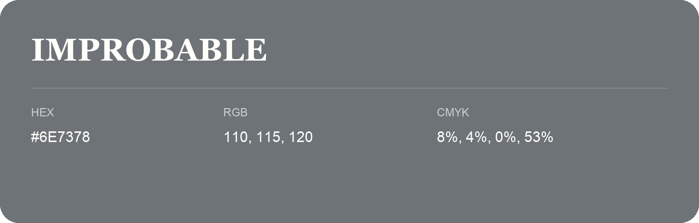

## Improbable

- HEX: #6E7378
- RGB: 110, 115, 120
- CMYK: 8%, 4%, 0%, 53%
- Character: restrained, grounded, sophisticated
- Suggested uses: premium brands, editorial typography, dark backgrounds

- Source images: IMG_9035.JPG
