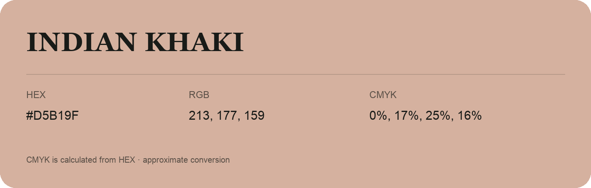

## Indian Khaki

- HEX: #D5B19F
- RGB: 213, 177, 159
- CMYK: 0%, 17%, 25%, 16%
- Character: soft, warm, playful
- Suggested uses: friendly consumer brands, gentle backgrounds, welcoming accents

- Source images: iCloud Photos 2/IMG_9152.JPG
- Data provenance: CMYK calculated from HEX; source text recognition was uncertain. Approximate conversion without a print color profile.
