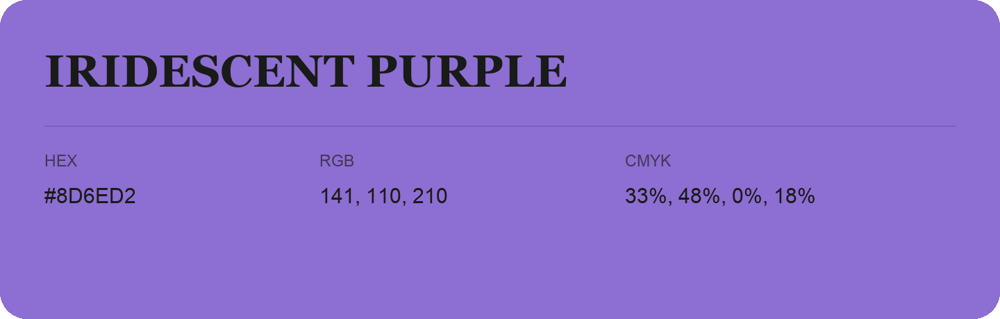

## Iridescent Purple

- HEX: #8D6ED2
- RGB: 141, 110, 210
- CMYK: 33%, 48%, 0%, 18%
- Character: cool, composed, dependable
- Suggested uses: professional services, technology brands, calm backgrounds

- Source images: iCloud Photos 2/IMG_9127.JPG
