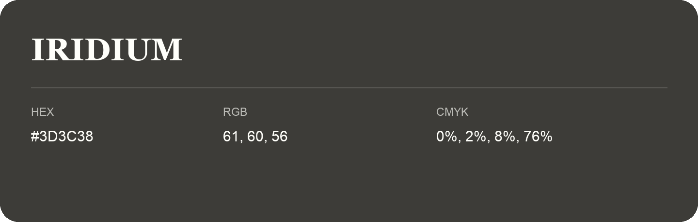

## Iridium

- HEX: #3D3C38
- RGB: 61, 60, 56
- CMYK: 0%, 2%, 8%, 76%
- Character: deep, grounded, understated
- Suggested uses: premium packaging, editorial typography, dark backgrounds

- Source images: iCloud Photos 2/IMG_9151.JPG
