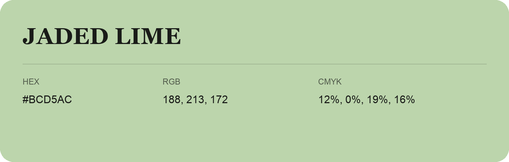

## Jaded Lime

- HEX: #BCD5AC
- RGB: 188, 213, 172
- CMYK: 12%, 0%, 19%, 16%
- Character: soft, gentle, approachable
- Suggested uses: friendly consumer brands, gentle backgrounds, welcoming accents

- Source images: IMG_9005.JPG

- Data provenance: RGB calculated from HEX, matching the page; source image RGB was unreadable.
