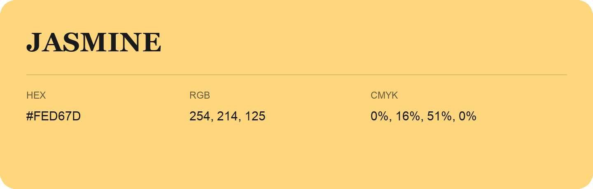

## Jasmine

- HEX: #FED67D
- RGB: 254, 214, 125
- CMYK: 0%, 16%, 51%, 0%
- Character: earthy, rich, warm
- Suggested uses: artisan businesses, hospitality brands, warm accents

- Source images: IMG_8987.JPG
