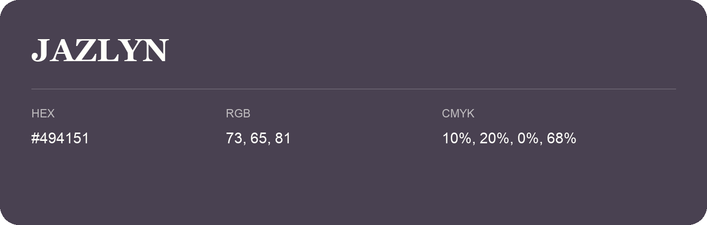

## Jazlyn

- HEX: #494151
- RGB: 73, 65, 81
- CMYK: 10%, 20%, 0%, 68%
- Character: expressive, imaginative, refined
- Suggested uses: beauty brands, creative businesses, distinctive accents

- Source images: IMG_9114.JPG
