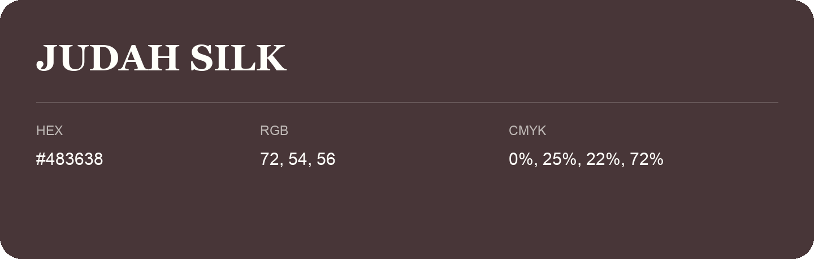

## Judah Silk

- HEX: #483638
- RGB: 72, 54, 56
- CMYK: 0%, 25%, 22%, 72%
- Character: warm, expressive, energetic
- Suggested uses: food brands, expressive identities, promotional accents

- Source images: IMG_9097.JPG
