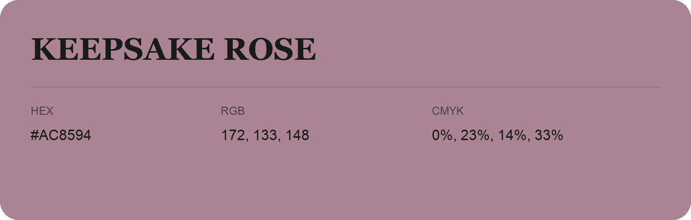

## Keepsake Rose

- HEX: #AC8594
- RGB: 172, 133, 148
- CMYK: 0%, 23%, 14%, 33%
- Character: expressive, imaginative, refined
- Suggested uses: beauty brands, creative businesses, distinctive accents

- Source images: IMG_9037.JPG

- Data provenance: RGB calculated from HEX, matching the page; source image RGB was unreadable.
