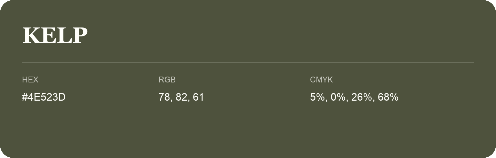

## Kelp

- HEX: #4E523D
- RGB: 78, 82, 61
- CMYK: 5%, 0%, 26%, 68%
- Character: natural, grounded, fresh
- Suggested uses: outdoor businesses, wellness brands, organic packaging

- Source images: IMG_9109.JPG
