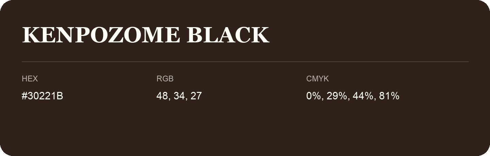

## Kenpozome Black

- HEX: #30221B
- RGB: 48, 34, 27
- CMYK: 0%, 29%, 44%, 81%
- Character: earthy, rich, warm
- Suggested uses: premium packaging, rustic brands, dark backgrounds

- Source images: IMG_9099.JPG
