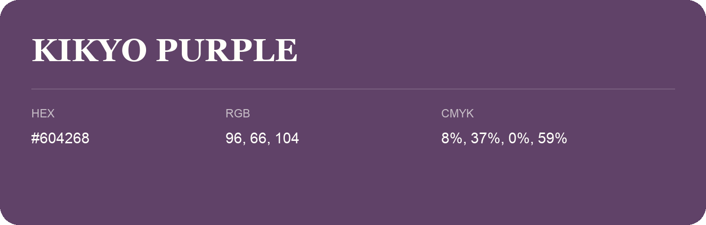

## Kikyo Purple

- HEX: #604268
- RGB: 96, 66, 104
- CMYK: 8%, 37%, 0%, 59%
- Character: expressive, imaginative, refined
- Suggested uses: beauty brands, creative businesses, distinctive accents

- Source images: IMG_9033.JPG
