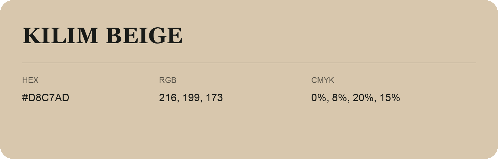

## Kilim Beige

- HEX: #D8C7AD
- RGB: 216, 199, 173
- CMYK: 0%, 8%, 20%, 15%
- Character: soft, gentle, approachable
- Suggested uses: friendly consumer brands, gentle backgrounds, welcoming accents

- Source images: iCloud Photos 2/IMG_9175.JPG
