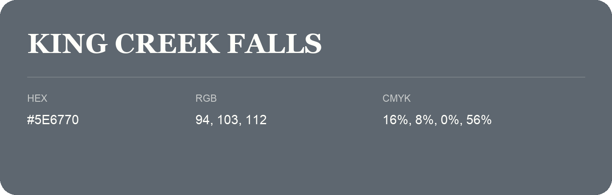

## King Creek Falls

- HEX: #5E6770
- RGB: 94, 103, 112
- CMYK: 16%, 8%, 0%, 56%
- Character: cool, composed, dependable
- Suggested uses: professional services, technology brands, calm backgrounds

- Source images: IMG_9104.JPG

- Data provenance: RGB calculated from HEX, matching the page; source image RGB was unreadable.
