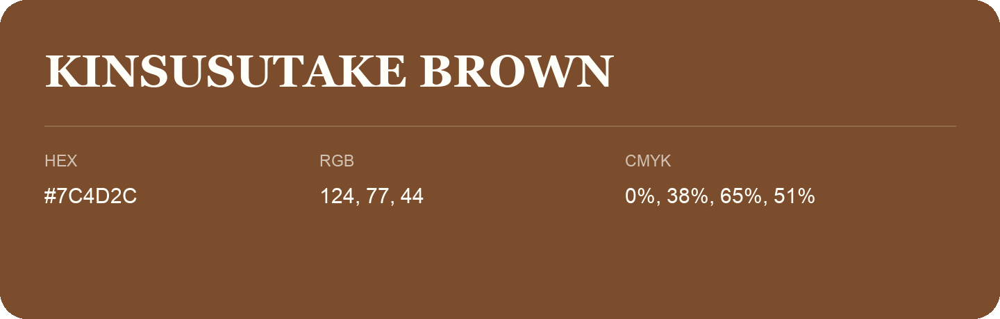

## Kinsusutake Brown

- HEX: #7C4D2C
- RGB: 124, 77, 44
- CMYK: 0%, 38%, 65%, 51%
- Character: earthy, rich, warm
- Suggested uses: premium packaging, rustic brands, dark backgrounds

- Source images: iCloud Photos 2/IMG_9135.JPG
