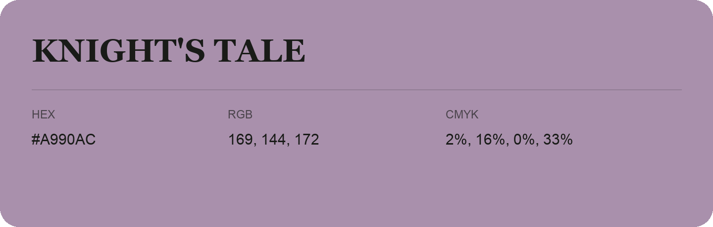

## Knight'S Tale

- HEX: #A990AC
- RGB: 169, 144, 172
- CMYK: 2%, 16%, 0%, 33%
- Character: expressive, imaginative, refined
- Suggested uses: beauty brands, creative businesses, distinctive accents

- Source images: IMG_9025.JPG
