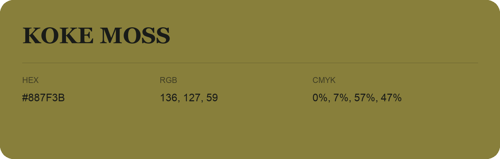

## Koke Moss

- HEX: #887F3B
- RGB: 136, 127, 59
- CMYK: 0%, 7%, 57%, 47%
- Character: sunny, lively, optimistic
- Suggested uses: friendly consumer brands, food packaging, cheerful accents

- Source images: IMG_8997.JPG
