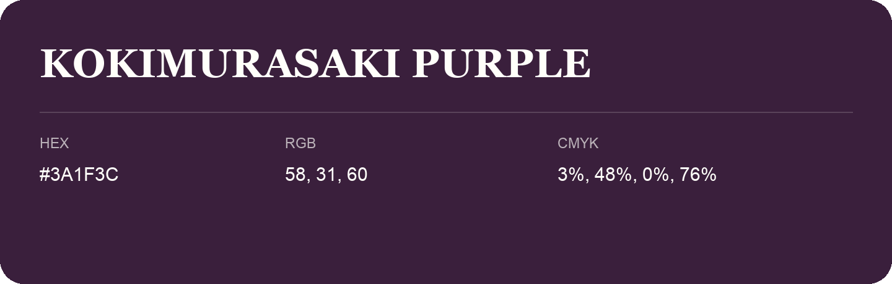

## Kokimurasaki Purple

- HEX: #3A1F3C
- RGB: 58, 31, 60
- CMYK: 3%, 48%, 0%, 76%
- Character: expressive, imaginative, refined
- Suggested uses: beauty brands, creative businesses, distinctive accents

- Source images: IMG_9033.JPG
