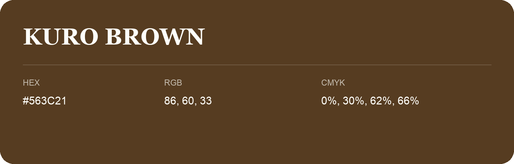

## Kuro Brown

- HEX: #563C21
- RGB: 86, 60, 33
- CMYK: 0%, 30%, 62%, 66%
- Character: earthy, rich, warm
- Suggested uses: premium packaging, rustic brands, dark backgrounds

- Source images: IMG_9008.JPG
