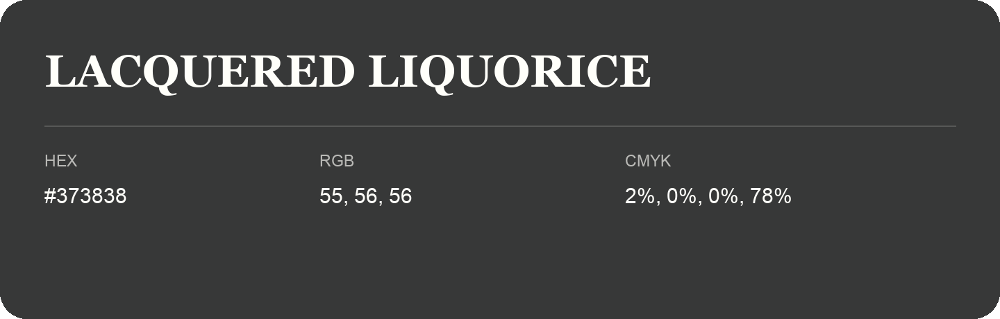

## Lacquered Liquorice

- HEX: #373838
- RGB: 55, 56, 56
- CMYK: 2%, 0%, 0%, 78%
- Character: restrained, grounded, sophisticated
- Suggested uses: premium brands, editorial typography, dark backgrounds

- Source images: IMG_9107.JPG
