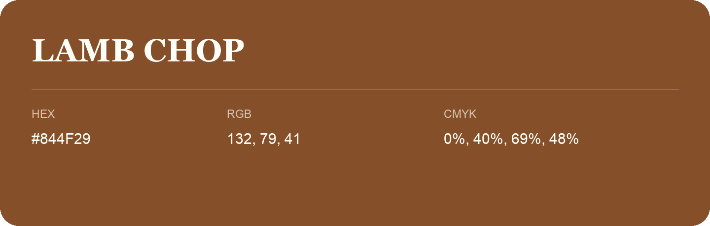

## Lamb Chop

- HEX: #844F29
- RGB: 132, 79, 41
- CMYK: 0%, 40%, 69%, 48%
- Character: earthy, rich, warm
- Suggested uses: premium packaging, rustic brands, dark backgrounds

- Source images: IMG_8979.JPG
