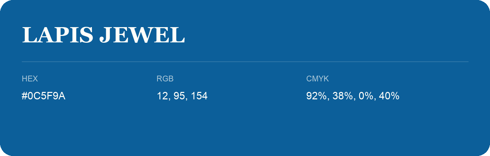

## Lapis Jewel

- HEX: #0C5F9A
- RGB: 12, 95, 154
- CMYK: 92%, 38%, 0%, 40%
- Character: cool, composed, dependable
- Suggested uses: professional services, technology brands, calm backgrounds

- Source images: IMG_9091.JPG

- Data provenance: HEX recovered from page data; cross-checked against the readable source RGB.
