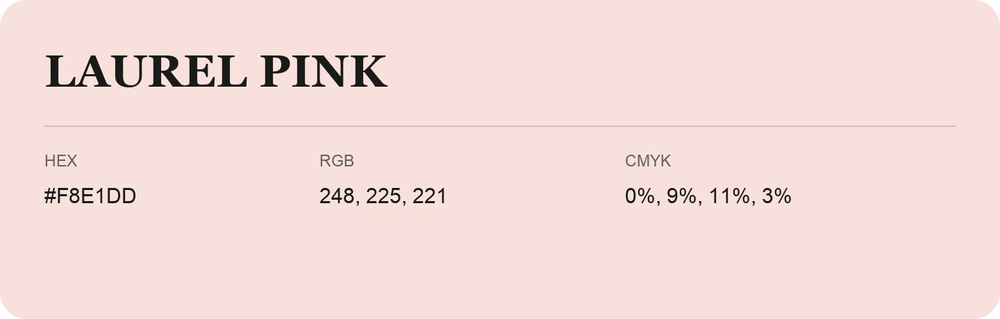

## Laurel Pink

- HEX: #F8E1DD
- RGB: 248, 225, 221
- CMYK: 0%, 9%, 11%, 3%
- Character: quiet, balanced, understated
- Suggested uses: professional services, minimal identities, supporting backgrounds

- Source images: iCloud Photos 2/IMG_9143.JPG
- Data provenance: RGB calculated from HEX; source text recognition was uncertain.
