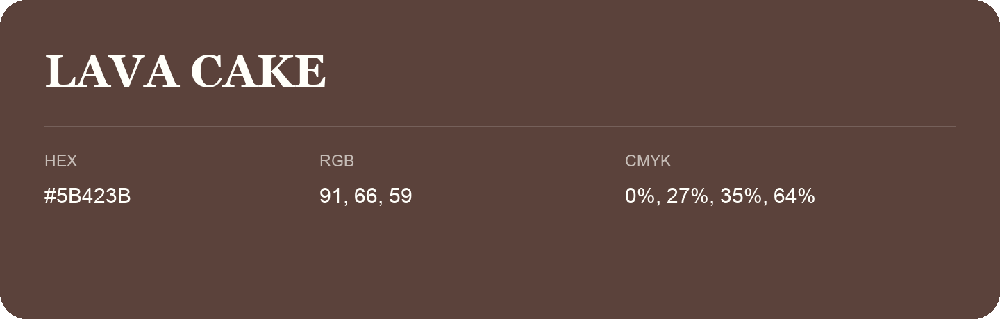

## Lava Cake

- HEX: #5B423B
- RGB: 91, 66, 59
- CMYK: 0%, 27%, 35%, 64%
- Character: warm, expressive, energetic
- Suggested uses: food brands, expressive identities, promotional accents

- Source images: IMG_9110.JPG
