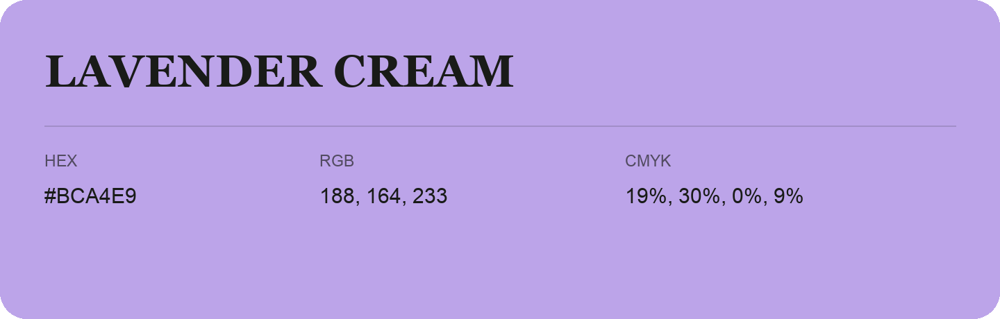

## Lavender Cream

- HEX: #BCA4E9
- RGB: 188, 164, 233
- CMYK: 19%, 30%, 0%, 9%
- Character: soft, gentle, approachable
- Suggested uses: friendly consumer brands, gentle backgrounds, welcoming accents

- Source images: iCloud Photos 2/IMG_9127.JPG
