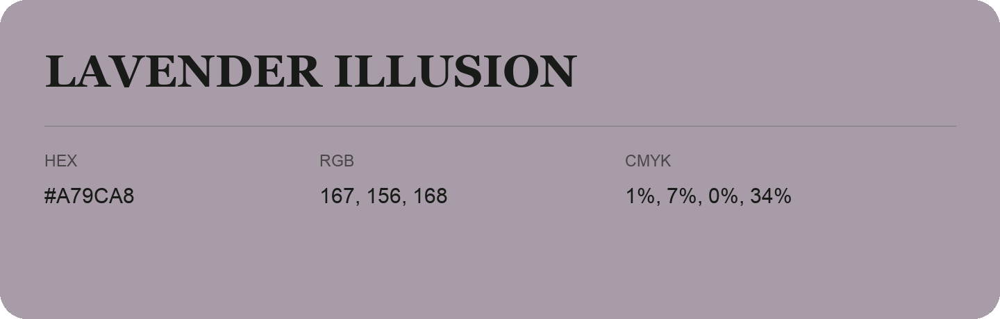

## Lavender Illusion

- HEX: #A79CA8
- RGB: 167, 156, 168
- CMYK: 1%, 7%, 0%, 34%
- Character: quiet, balanced, understated
- Suggested uses: professional services, minimal identities, supporting backgrounds

- Source images: IMG_9118.JPG
