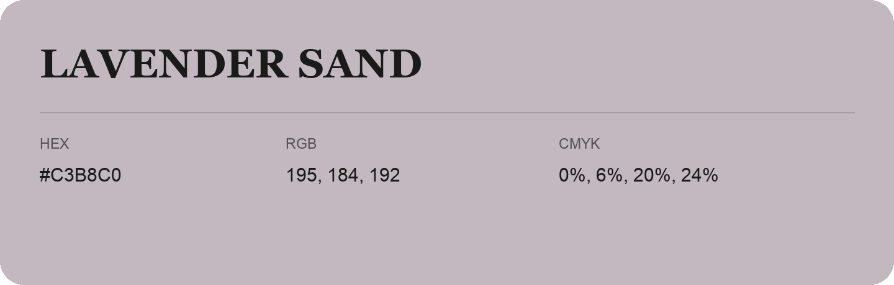

## Lavender Sand

- HEX: #C3B8C0
- RGB: 195, 184, 192
- CMYK: 0%, 6%, 20%, 24%
- Character: quiet, balanced, understated
- Suggested uses: professional services, minimal identities, supporting backgrounds

- Source images: iCloud Photos 2/IMG_9172.JPG
