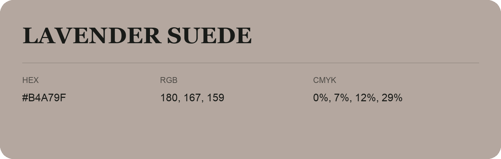

## Lavender Suede

- HEX: #B4A79F
- RGB: 180, 167, 159
- CMYK: 0%, 7%, 12%, 29%
- Character: quiet, balanced, understated
- Suggested uses: professional services, minimal identities, supporting backgrounds

- Source images: IMG_8996.JPG

- Data provenance: RGB calculated from HEX, matching the page; source image RGB was unreadable.
