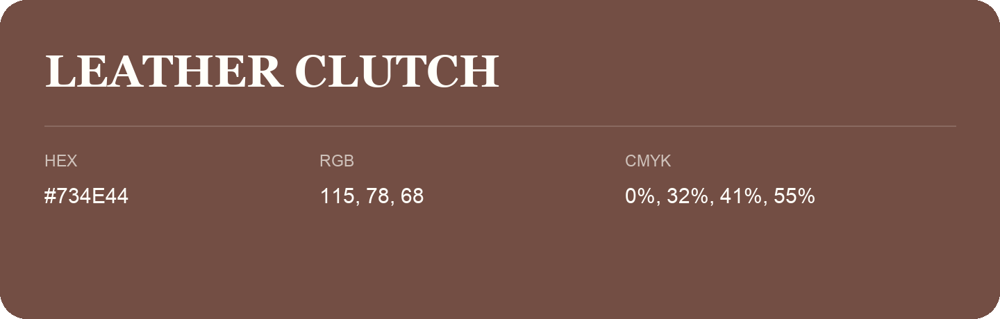

## Leather Clutch

- HEX: #734E44
- RGB: 115, 78, 68
- CMYK: 0%, 32%, 41%, 55%
- Character: warm, expressive, energetic
- Suggested uses: food brands, expressive identities, promotional accents

- Source images: IMG_9078.JPG
