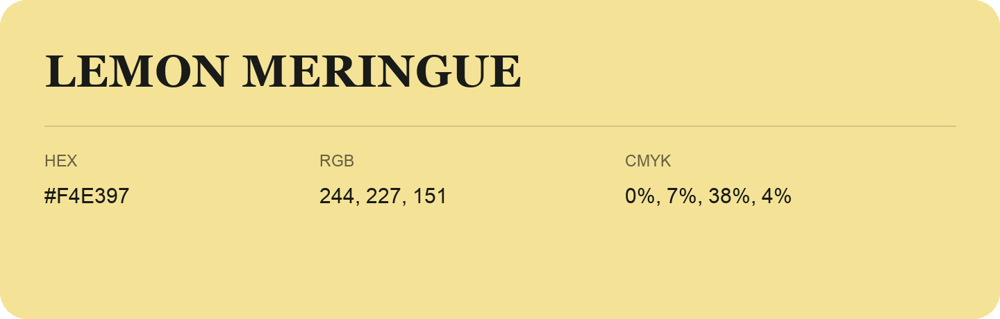

## Lemon Meringue

- HEX: #F4E397
- RGB: 244, 227, 151
- CMYK: 0%, 7%, 38%, 4%
- Character: soft, gentle, approachable
- Suggested uses: friendly consumer brands, gentle backgrounds, welcoming accents

- Source images: IMG_9027.JPG
