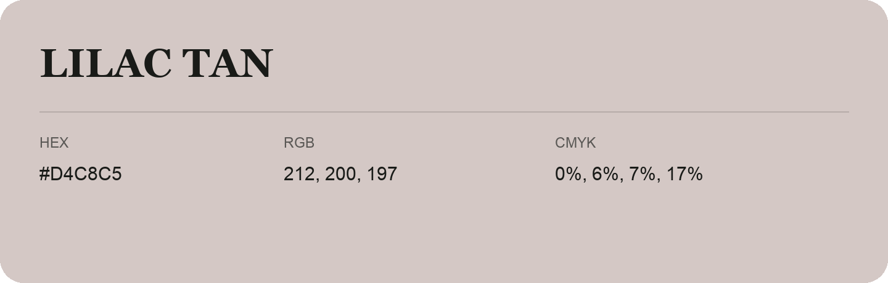

## Lilac Tan

- HEX: #D4C8C5
- RGB: 212, 200, 197
- CMYK: 0%, 6%, 7%, 17%
- Character: quiet, balanced, understated
- Suggested uses: professional services, minimal identities, supporting backgrounds

- Source images: iCloud Photos 2/IMG_9168.JPG
