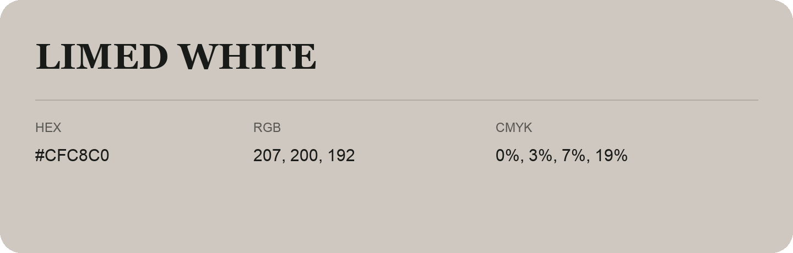

## Limed White

- HEX: #CFC8C0
- RGB: 207, 200, 192
- CMYK: 0%, 3%, 7%, 19%
- Character: quiet, balanced, understated
- Suggested uses: professional services, minimal identities, supporting backgrounds

- Source images: IMG_8999.JPG

- Data provenance: HEX recovered from page data; cross-checked against the readable source RGB.
