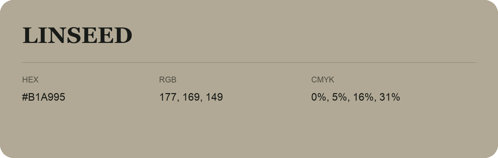

## Linseed

- HEX: #B1A995
- RGB: 177, 169, 149
- CMYK: 0%, 5%, 16%, 31%
- Character: earthy, rich, warm
- Suggested uses: artisan businesses, hospitality brands, warm accents

- Source images: IMG_9035.JPG
