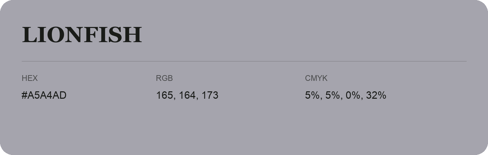

## Lionfish

- HEX: #A5A4AD
- RGB: 165, 164, 173
- CMYK: 5%, 5%, 0%, 32%
- Character: quiet, balanced, understated
- Suggested uses: professional services, minimal identities, supporting backgrounds

- Source images: IMG_9053.JPG
