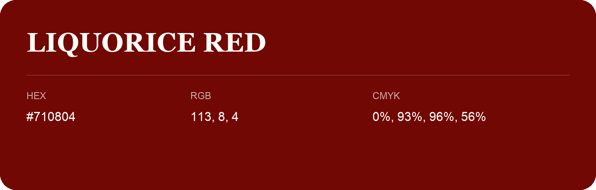

## Liquorice Red

- HEX: #710804
- RGB: 113, 8, 4
- CMYK: 0%, 93%, 96%, 56%
- Character: warm, expressive, energetic
- Suggested uses: food brands, expressive identities, promotional accents

- Source images: iCloud Photos 2/IMG_9125.JPG
