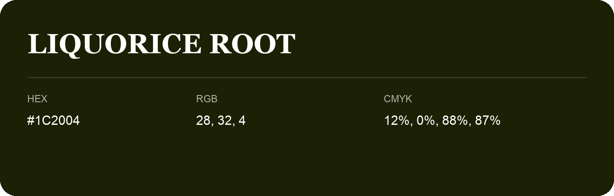

## Liquorice Root

- HEX: #1C2004
- RGB: 28, 32, 4
- CMYK: 12%, 0%, 88%, 87%
- Character: deep, grounded, understated
- Suggested uses: premium packaging, editorial typography, dark backgrounds

- Source images: iCloud Photos 2/IMG_9124.JPG
