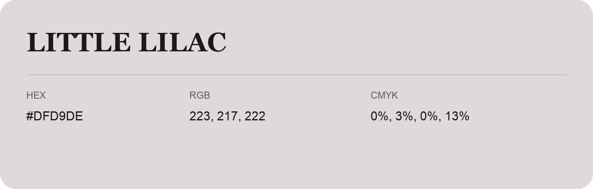

## Little Lilac

- HEX: #DFD9DE
- RGB: 223, 217, 222
- CMYK: 0%, 3%, 0%, 13%
- Character: quiet, balanced, understated
- Suggested uses: professional services, minimal identities, supporting backgrounds

- Source images: IMG_9112.JPG
