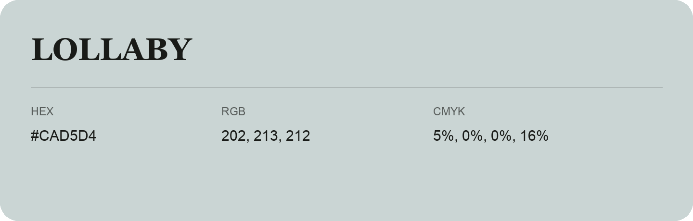

## Lollaby

- HEX: #CAD5D4
- RGB: 202, 213, 212
- CMYK: 5%, 0%, 0%, 16%
- Character: quiet, balanced, understated
- Suggested uses: professional services, minimal identities, supporting backgrounds

- Source images: iCloud Photos 2/IMG_9148.JPG
- Data provenance: RGB calculated from HEX; source text recognition was uncertain.
