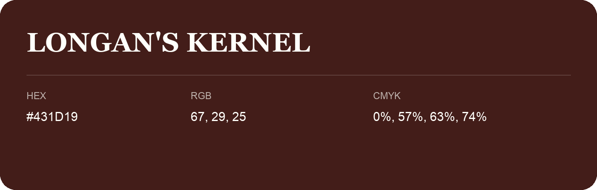

## Longan'S Kernel

- HEX: #431D19
- RGB: 67, 29, 25
- CMYK: 0%, 57%, 63%, 74%
- Character: deep, grounded, understated
- Suggested uses: premium packaging, editorial typography, dark backgrounds

- Source images: iCloud Photos 2/IMG_9184.JPG
