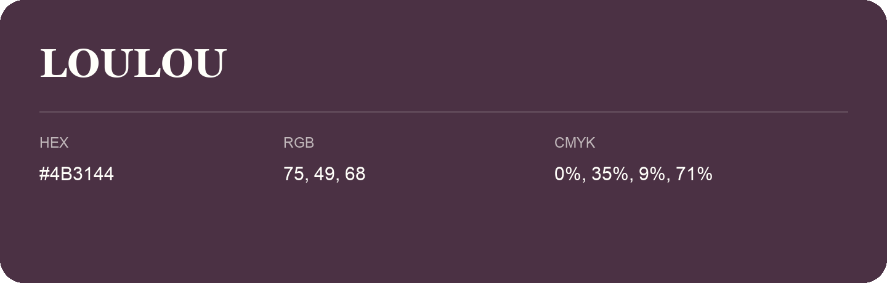

## Loulou

- HEX: #4B3144
- RGB: 75, 49, 68
- CMYK: 0%, 35%, 9%, 71%
- Character: deep, grounded, understated
- Suggested uses: premium packaging, editorial typography, dark backgrounds

- Source images: iCloud Photos 2/IMG_9155.JPG
